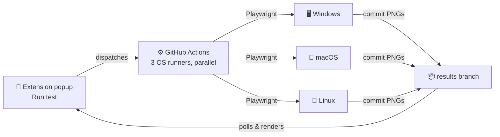

<p align="center">
  
</p>

<p align="center">
  
  
  
  
</p>

Click a button in a Chrome extension. Get back real screenshots of your page
from a real Windows machine, a real Mac, and a real Linux box — without
paying for BrowserStack, LambdaTest, or any device farm.

## How

GitHub gives every repo free, real OS runners for CI. This project just
points that at your website instead of at test suites.



No server to host. No paid API. Your GitHub account is the whole backend.

## What it looks like

<p align="center">
  
</p>

Each OS updates independently the moment it finishes — Linux and Windows
runners are usually done in under a minute; macOS runners take longer to
spin up, so you're not stuck watching one spinner for five minutes with no
idea what's happening.

## Setup

Five steps, about ten minutes total, all one-time.

| # | Step | Where |
|---|------|-------|
| 1 | Push this repo to GitHub | your terminal |
| 2 | Create an empty `results` branch | your terminal |
| 3 | Generate a fine-grained PAT scoped to this repo, with **Contents: Read & write** and **Actions: Read & write** | github.com/settings/tokens |
| 4 | Load the `extension/` folder as an unpacked extension | `chrome://extensions` |
| 5 | Paste the token once in the extension's settings | popup → ⚙ |

Full commands and exact permission screenshots are in the steps below.

<details>
<summary><strong>1–2: Push the repo and create the results branch</strong></summary>

```bash
git init
git add .
git commit -m "Initial cross-OS tester setup"
git branch -M main
git remote add origin https://github.com/<you>/<repo>.git
git push -u origin main

git checkout --orphan results
git rm -rf .
git commit --allow-empty -m "Initial empty results branch"
git push origin results
git checkout main
```
</details>

<details>
<summary><strong>3: Generate the token</strong></summary>

github.com → **Settings** → **Developer settings** → **Personal access
tokens** → **Fine-grained tokens** → **Generate new token**

- Repository access: **Only select repositories** → this repo
- Permissions: **Contents → Read and write**, **Actions → Read and write**

</details>

<details>
<summary><strong>4–5: Load and configure the extension</strong></summary>

1. `chrome://extensions` → enable **Developer mode**
2. **Load unpacked** → select the `extension/` folder
3. Click the extension icon — first run opens setup automatically
4. Paste the token, your GitHub username, and the repo name — saved once,
   used forever after

</details>

## Using it

Open any page, click the extension icon, click **Run test**. Screenshots
appear in the popup as each OS finishes — click one to expand it inline.

## Extending it

- **More browsers per OS** — edit `TEST_COMBINATIONS` in `extension/background.js`;
  Playwright supports `firefox` and `webkit` the same way as `chromium`.
- **History instead of just the latest run** — point a database at the
  `results` branch's contents instead of only showing the newest.
- **Fewer Actions minutes** — macOS runners cost 10× your free-tier quota
  versus Linux; drop `macos-latest` from the workflow matrix if you mostly
  care about Windows vs. Linux.

## Known limitations

- WebKit-on-Linux approximates Safari's engine, not real macOS Safari —
  fine for layout bugs, not for font-hinting-level nitpicks.
- The `results` branch grows forever — nothing prunes old screenshots yet.
  Fine for a while; eventually worth deleting old `results/run-*` folders.
- MV3 service workers can be killed by Chrome if idle too long mid-poll —
  if a run seems stuck, reopening the popup and clicking **Run test** again
  is the recovery.
- A leaked token lets someone trigger workflow runs on your account — don't
  commit it, don't share the extension's storage.
