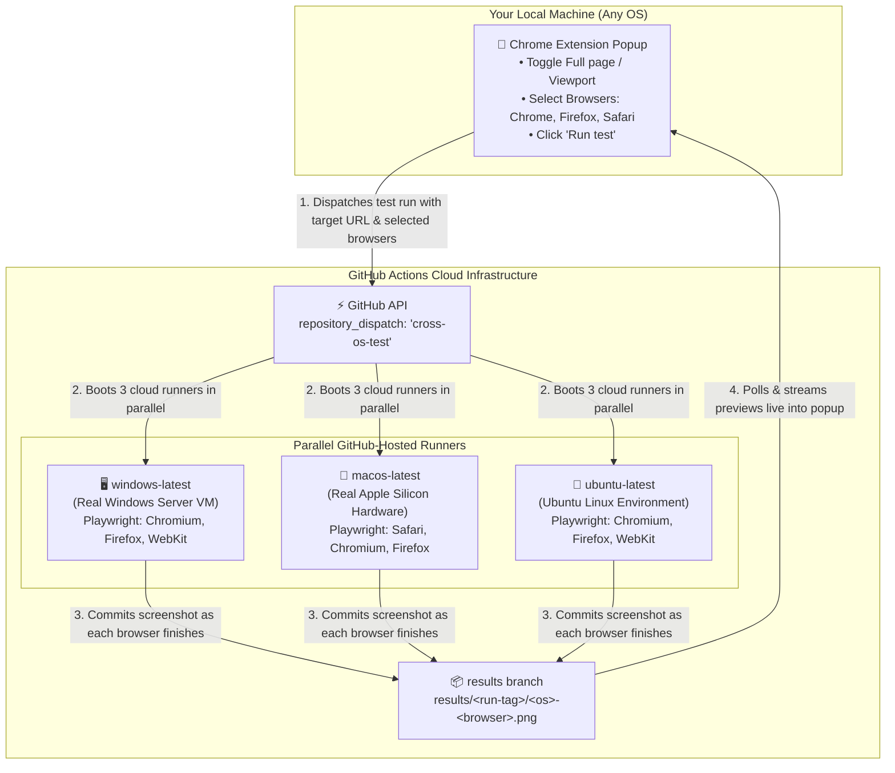
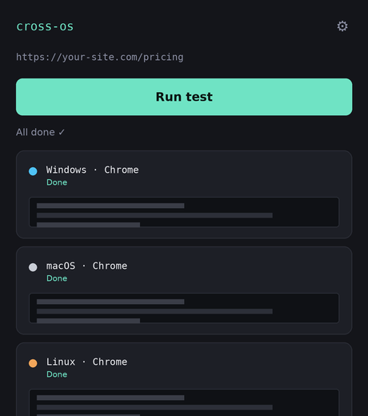

<p align="center">
  
</p>

<p align="center">
  
  
  
  
</p>

## Overview

> [!IMPORTANT]
> ### 💡 Critical FAQ: Does my repository need to be Public? Will I be charged?
> **No! It works on both Public and Private repositories for $0, and GitHub will never charge your card.**
>
> | Repository Type | Operating Systems Available | Monthly Minutes | Privacy |
> | :--- | :--- | :--- | :--- |
> | **Public Repository** | Windows, macOS, Linux | **Unlimited & Free ($0)** | Screenshots on `results` branch are public |
> | **Private Repository** | Windows, macOS, Linux | **2,000 Free minutes / month** | **100% Private** (only you can see screenshots & URLs) |
>
> - **Can private repos run macOS and Windows for free?** Yes! Standard `windows-latest` and `macos-latest` runners are available to all free GitHub accounts on private repositories.
> - **The macOS Quota Multiplier (Private Repos Only)**: On private repositories, Linux consumes 1× quota, Windows consumes 2×, and macOS consumes 10× (1 minute of Mac run time = 10 minutes from your 2,000-minute allowance). Your 2,000 free monthly minutes provide ~200 real minutes of macOS runs (~50 to 100 complete test runs).
> - **Zero Surprise Charges**: Every GitHub account comes with a default **$0.00 spending limit**. If you ever run out of free minutes, workflows simply pause until the next month. GitHub will **never** charge your card without you explicitly configuring a paid spending limit.
>
> **Recommendation:**
> - **Keep it Private** if you are testing client projects, staging environments, or internal apps and want privacy.
> - **Make it Public** if you test hundreds of times a day and want unlimited free runner minutes.

### What problem does this solve?

A website can look slightly different depending on the computer it's
opened on — different operating system, different browser, different font
rendering. Big companies pay for services like BrowserStack that let you
open your site on lots of different real computers to check. Those
services usually cost money.

This project does the same thing, but for free, using a trick most
people don't know about yet.

### Where does the ability to test different operating systems come from?

Your own computer doesn't need to run Windows or macOS. Instead, this project borrows **real, cloud-hosted computers directly from GitHub**:

- **Windows (`windows-latest`)**: Real Windows Server virtual machines hosted in Microsoft Azure data centers.
- **macOS (`macos-latest`)**: Genuine **Apple Mac hardware** hosted in GitHub's data centers, rendering fonts and styling using macOS's native graphics engine.
- **Linux (`ubuntu-latest`)**: High-performance Ubuntu Linux cloud runners.

Commercial testing platforms (such as BrowserStack, SauceLabs, or LambdaTest) charge between $30 and $150+ every month just to rent access to remote Windows and Mac machines. But GitHub already gives every free account **2,000 free Actions runner minutes every month**. This project repurposes those CI runners into your own private, zero-cost cross-OS and cross-browser device lab.

### What actually happens, step by step

1. You install the small **Chrome extension** in your browser.
2. You open any website, pick which browsers you want to test (**Chrome**, **Firefox**, **Safari / WebKit**), and click **Run test**.
3. The extension sends a lightweight message (`repository_dispatch`) to your GitHub repository saying: *"Spin up 3 computers — Windows, Mac, and Linux — and capture this URL."*
4. GitHub boots those runners in parallel in its cloud data centers.
5. On each machine, **Playwright** launches the native browser engines on that operating system, navigates to your page, and captures pixel-perfect screenshots.
6. As each browser finishes, the runner commits the PNG directly to your repo's `results` branch.
7. The extension popup polls your GitHub repo and streams in each preview image the moment it is committed.

You never have to maintain or touch a Windows or Mac computer yourself — GitHub's cloud does all the heavy lifting.

### A few words you'll see a lot, explained simply

| Word | What it actually means here |
|---|---|
| **Repo (repository)** | A folder for your project, stored on GitHub, with a history of every change ever made to it (that history is called **git**). |
| **Chrome extension** | A small program that adds a feature to your browser — in this case, a popup with a button. |
| **GitHub Actions / workflow** | A recipe file (`.yml`) that tells GitHub "when X happens, start a computer and run these commands." |
| **Runner** | One of those temporary computers GitHub starts for you. |
| **Token (PAT)** | A long, secret password-like code that proves to GitHub "this extension is allowed to act on my behalf." Never share it or paste it anywhere public. |
| **Branch** | A separate "version" of your project's history. This project uses one branch (`main`) for the actual code, and a second branch (`results`) purely as a storage bin for screenshots. |

### Setting it up, step by step

You'll need: a free [GitHub account](https://github.com), [Git](https://git-scm.com/downloads)
installed on your computer, and [Google Chrome](https://www.google.com/chrome/).

1. **Create a new, empty repository** on github.com (click the **+** in the
   top right → **New repository**). Don't add a README when it asks — this
   project already has one.
2. **Open a terminal** (Terminal app on Mac, Command Prompt or PowerShell
   on Windows) and navigate into this project's folder using `cd`.
3. **Copy-paste these commands one at a time**, replacing `<you>` and
   `<repo>` with your actual GitHub username and repo name:
   ```bash
   git init
   git add .
   git commit -m "Initial cross-OS tester setup"
   git branch -M main
   git remote add origin https://github.com/<you>/<repo>.git
   git push -u origin main
   ```
   Each line does one thing: `init` starts tracking this folder with git,
   `add`/`commit` save a snapshot, and `remote add`/`push` upload that
   snapshot to GitHub.
4. **Create the second branch** (the screenshot storage bin):
   ```bash
   git checkout --orphan results
   git rm -rf .
   git commit --allow-empty -m "Initial empty results branch"
   git push origin results
   git checkout main
   ```
5. **Get a token** so the extension is allowed to talk to your repo:
   github.com → click your profile picture → **Settings** → **Developer
   settings** → **Personal access tokens** → **Fine-grained tokens** →
   **Generate new token**. Set repository access to only this repo, and
   turn on **Contents: Read and write** and **Actions: Read and write**.
   Copy the token somewhere safe — GitHub only shows it once.
6. **Load the extension**: open `chrome://extensions` in Chrome, turn on
   **Developer mode** (top right), click **Load unpacked**, and select
   this project's `extension` folder.
7. **Paste your token**: click the extension's icon, then the ⚙ settings
   icon, and paste in the token plus your GitHub username and repo name.

That's the whole setup. From here on, just open any website and click
**Run test**.


Click a button in a Chrome extension. Get back real screenshots of your page
from a real Windows machine, a real Mac, and a real Linux box — without
paying for BrowserStack, LambdaTest, or any device farm.

## How

## How it works: Free multi-OS & multi-browser cloud infrastructure

Instead of paying a commercial provider for remote testing VMs, this project leverages GitHub's cloud CI infrastructure:



### Why this works so well

- **Authentic font and layout rendering**: Rather than trying to emulate or spoof user agents, screenshots are captured on **real Windows Server VMs** and **real Apple Mac hardware**. On macOS, font smoothing, subpixel rendering, and WebKit/Safari behavior match actual Mac machines.
- **Efficient runner utilization**: Each OS runner boots once and handles the requested browsers sequentially, meaning you get all requested browsers on that OS without multiplying VM boots or wasting your 2,000 free monthly Actions quota.
- **Serverless & free**: No backend server to host, no database to maintain, and zero subscriptions. Your GitHub account is the entire test lab.

## What it looks like

<p align="center">
  
</p>

Each OS updates independently the moment it finishes — Linux and Windows
runners are usually done in under a minute; macOS runners take longer to
spin up, so you're not stuck watching one spinner for five minutes with no
idea what's happening.

## Setup

Five steps, about ten minutes total, all one-time.

| # | Step | Where |
|---|------|-------|
| 1 | Push this repo to GitHub | your terminal |
| 2 | Create an empty `results` branch | your terminal |
| 3 | Generate a fine-grained PAT scoped to this repo, with **Contents: Read & write** and **Actions: Read & write** | github.com/settings/tokens |
| 4 | Load the `extension/` folder as an unpacked extension | `chrome://extensions` |
| 5 | Paste the token once in the extension's settings | popup → ⚙ |

Full commands and exact permission screenshots are in the steps below.

<details>
<summary><strong>1–2: Push the repo and create the results branch</strong></summary>

```bash
git init
git add .
git commit -m "Initial cross-OS tester setup"
git branch -M main
git remote add origin https://github.com/<you>/<repo>.git
git push -u origin main

git checkout --orphan results
git rm -rf .
git commit --allow-empty -m "Initial empty results branch"
git push origin results
git checkout main
```
</details>

<details>
<summary><strong>3: Generate the token</strong></summary>

github.com → **Settings** → **Developer settings** → **Personal access
tokens** → **Fine-grained tokens** → **Generate new token**

- Repository access: **Only select repositories** → this repo
- Permissions: **Contents → Read and write**, **Actions → Read and write**

</details>

<details>
<summary><strong>4–5: Load and configure the extension</strong></summary>

1. `chrome://extensions` → enable **Developer mode**
2. **Load unpacked** → select the `extension/` folder
3. Click the extension icon — first run opens setup automatically
4. Paste the token, your GitHub username, and the repo name — saved once,
   used forever after

</details>

## Testing

```bash
npm test
```

Runs an integration test suite against the *real* `background.js` and
`popup.js` — not reimplemented copies. It loads the actual files in a
sandboxed VM with mocked `chrome.*`/`fetch` APIs and drives them through
their real entry points, covering:

- the happy path (all 3 OSes stream in independently)
- missing credentials failing fast without hitting the network
- a rejected dispatch (e.g. under-scoped token) failing fast
- the 6-minute timeout path
- popup-disconnect-mid-run stopping cleanly instead of throwing
- a byte-exact round-trip test of the base64 image encoding across chunk boundaries
- the double-click race (this test fails against the pre-fix code — verified by hand)

A separate CI workflow (`.github/workflows/test.yml`) runs this suite plus
[actionlint](https://github.com/rhysd/actionlint) on every push, so a future
change that reintroduces one of these bugs gets caught before it reaches
`main`, not just by manual review.

## Using it

Open any page, click the extension icon, click **Run test**. Screenshots
appear in the popup as each OS finishes — click one to expand it inline.

The **Full page** toggle above the button controls how much of the page
gets captured: on (default) scrolls through and stitches the entire page,
off captures just what's visible in the viewport. Long, tall pages are
easier to actually read as a viewport-only shot in the small popup preview
— the full-page version is still useful, just better viewed at full
resolution from the `results` branch on GitHub directly.

## Extending it

- **More browsers per OS** — edit `TEST_COMBINATIONS` in `extension/background.js`;
  Playwright supports `firefox` and `webkit` the same way as `chromium`.
- **History instead of just the latest run** — point a database at the
  `results` branch's contents instead of only showing the newest.
- **Fewer Actions minutes** — macOS runners cost 10× your free-tier quota
  versus Linux; drop `macos-latest` from the workflow matrix if you mostly
  care about Windows vs. Linux.

## Known limitations

- WebKit-on-Linux approximates Safari's engine, not real macOS Safari —
  fine for layout bugs, not for font-hinting-level nitpicks.
- The `results` branch grows forever — nothing prunes old screenshots yet.
  Fine for a while; eventually worth deleting old `results/run-*` folders.
- MV3 service workers can be killed by Chrome if idle too long mid-poll —
  if a run seems stuck, reopening the popup and clicking **Run test** again
  is the recovery.
- A leaked token lets someone trigger workflow runs on your account — don't
  commit it, don't share the extension's storage.
