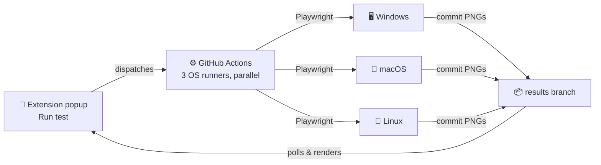

<p align="center">
  
</p>

<p align="center">
  
  
  
  
</p>

## New to coding? Start here 👋

If you already know what a Chrome extension, a git repo, and CI are, skip
down to [How](#how) — this section is a slow, no-jargon walkthrough for
anyone still learning.

### What problem does this solve?

A website can look slightly different depending on the computer it's
opened on — different operating system, different browser, different font
rendering. Big companies pay for services like BrowserStack that let you
open your site on lots of different real computers to check. Those
services usually cost money.

This project does the same thing, but for free, using a trick most
beginners don't know about yet.

### The trick: GitHub already owns free computers you can borrow

When you create a project on GitHub, GitHub gives you access to
**"Actions"** — a feature that lets you run code on real, temporary
computers in GitHub's data centers, for free, up to a generous monthly
limit. People normally use this to automatically test their code every
time they save it. This project points that same feature at a *website*
instead of at code, and takes a screenshot with it.

### What actually happens, step by step

1. You install a small **Chrome extension** (a mini-program that adds a
   button to your browser).
2. You click that button while looking at a webpage.
3. The extension sends a message to GitHub saying "please start 3
   computers — one Windows, one Mac, one Linux — and open this URL on
   each of them."
4. GitHub spins up those 3 computers (this takes a minute or two).
5. Each computer opens the page using a tool called **Playwright** (code
   that can control a web browser automatically) and takes a screenshot.
6. Each computer saves its screenshot into your GitHub project.
7. The extension keeps checking GitHub every few seconds — "is the
   screenshot ready yet?" — and shows each one in its popup the moment
   it appears.

You never touch a Windows or Mac computer yourself. GitHub's computers do
the work; your extension just asks for it and shows you the result.

### A few words you'll see a lot, explained simply

| Word | What it actually means here |
|---|---|
| **Repo (repository)** | A folder for your project, stored on GitHub, with a history of every change ever made to it (that history is called **git**). |
| **Chrome extension** | A small program that adds a feature to your browser — in this case, a popup with a button. |
| **GitHub Actions / workflow** | A recipe file (`.yml`) that tells GitHub "when X happens, start a computer and run these commands." |
| **Runner** | One of those temporary computers GitHub starts for you. |
| **Token (PAT)** | A long, secret password-like code that proves to GitHub "this extension is allowed to act on my behalf." Never share it or paste it anywhere public. |
| **Branch** | A separate "version" of your project's history. This project uses one branch (`main`) for the actual code, and a second branch (`results`) purely as a storage bin for screenshots. |

### Setting it up (beginner pace)

You'll need: a free [GitHub account](https://github.com), [Git](https://git-scm.com/downloads)
installed on your computer, and [Google Chrome](https://www.google.com/chrome/).

1. **Create a new, empty repository** on github.com (click the **+** in the
   top right → **New repository**). Don't add a README when it asks — this
   project already has one.
2. **Open a terminal** (Terminal app on Mac, Command Prompt or PowerShell
   on Windows) and navigate into this project's folder using `cd`.
3. **Copy-paste these commands one at a time**, replacing `<you>` and
   `<repo>` with your actual GitHub username and repo name:
   ```bash
   git init
   git add .
   git commit -m "Initial cross-OS tester setup"
   git branch -M main
   git remote add origin https://github.com/<you>/<repo>.git
   git push -u origin main
   ```
   Each line does one thing: `init` starts tracking this folder with git,
   `add`/`commit` save a snapshot, and `remote add`/`push` upload that
   snapshot to GitHub.
4. **Create the second branch** (the screenshot storage bin):
   ```bash
   git checkout --orphan results
   git rm -rf .
   git commit --allow-empty -m "Initial empty results branch"
   git push origin results
   git checkout main
   ```
5. **Get a token** so the extension is allowed to talk to your repo:
   github.com → click your profile picture → **Settings** → **Developer
   settings** → **Personal access tokens** → **Fine-grained tokens** →
   **Generate new token**. Set repository access to only this repo, and
   turn on **Contents: Read and write** and **Actions: Read and write**.
   Copy the token somewhere safe — GitHub only shows it once.
6. **Load the extension**: open `chrome://extensions` in Chrome, turn on
   **Developer mode** (top right), click **Load unpacked**, and select
   this project's `extension` folder.
7. **Paste your token**: click the extension's icon, then the ⚙ settings
   icon, and paste in the token plus your GitHub username and repo name.

That's the whole setup. From here on, just open any website and click
**Run test**.


Click a button in a Chrome extension. Get back real screenshots of your page
from a real Windows machine, a real Mac, and a real Linux box — without
paying for BrowserStack, LambdaTest, or any device farm.

## How

GitHub gives every repo free, real OS runners for CI. This project just
points that at your website instead of at test suites.



No server to host. No paid API. Your GitHub account is the whole backend.

## What it looks like

<p align="center">
  
</p>

Each OS updates independently the moment it finishes — Linux and Windows
runners are usually done in under a minute; macOS runners take longer to
spin up, so you're not stuck watching one spinner for five minutes with no
idea what's happening.

## Setup

Five steps, about ten minutes total, all one-time.

| # | Step | Where |
|---|------|-------|
| 1 | Push this repo to GitHub | your terminal |
| 2 | Create an empty `results` branch | your terminal |
| 3 | Generate a fine-grained PAT scoped to this repo, with **Contents: Read & write** and **Actions: Read & write** | github.com/settings/tokens |
| 4 | Load the `extension/` folder as an unpacked extension | `chrome://extensions` |
| 5 | Paste the token once in the extension's settings | popup → ⚙ |

Full commands and exact permission screenshots are in the steps below.

<details>
<summary><strong>1–2: Push the repo and create the results branch</strong></summary>

```bash
git init
git add .
git commit -m "Initial cross-OS tester setup"
git branch -M main
git remote add origin https://github.com/<you>/<repo>.git
git push -u origin main

git checkout --orphan results
git rm -rf .
git commit --allow-empty -m "Initial empty results branch"
git push origin results
git checkout main
```
</details>

<details>
<summary><strong>3: Generate the token</strong></summary>

github.com → **Settings** → **Developer settings** → **Personal access
tokens** → **Fine-grained tokens** → **Generate new token**

- Repository access: **Only select repositories** → this repo
- Permissions: **Contents → Read and write**, **Actions → Read and write**

</details>

<details>
<summary><strong>4–5: Load and configure the extension</strong></summary>

1. `chrome://extensions` → enable **Developer mode**
2. **Load unpacked** → select the `extension/` folder
3. Click the extension icon — first run opens setup automatically
4. Paste the token, your GitHub username, and the repo name — saved once,
   used forever after

</details>

## Testing

```bash
npm test
```

Runs an integration test suite against the *real* `background.js` and
`popup.js` — not reimplemented copies. It loads the actual files in a
sandboxed VM with mocked `chrome.*`/`fetch` APIs and drives them through
their real entry points, covering:

- the happy path (all 3 OSes stream in independently)
- missing credentials failing fast without hitting the network
- a rejected dispatch (e.g. under-scoped token) failing fast
- the 6-minute timeout path
- popup-disconnect-mid-run stopping cleanly instead of throwing
- a byte-exact round-trip test of the base64 image encoding across chunk boundaries
- the double-click race (this test fails against the pre-fix code — verified by hand)

A separate CI workflow (`.github/workflows/test.yml`) runs this suite plus
[actionlint](https://github.com/rhysd/actionlint) on every push, so a future
change that reintroduces one of these bugs gets caught before it reaches
`main`, not just by manual review.

## Using it

Open any page, click the extension icon, click **Run test**. Screenshots
appear in the popup as each OS finishes — click one to expand it inline.

The **Full page** toggle above the button controls how much of the page
gets captured: on (default) scrolls through and stitches the entire page,
off captures just what's visible in the viewport. Long, tall pages are
easier to actually read as a viewport-only shot in the small popup preview
— the full-page version is still useful, just better viewed at full
resolution from the `results` branch on GitHub directly.

## Extending it

- **More browsers per OS** — edit `TEST_COMBINATIONS` in `extension/background.js`;
  Playwright supports `firefox` and `webkit` the same way as `chromium`.
- **History instead of just the latest run** — point a database at the
  `results` branch's contents instead of only showing the newest.
- **Fewer Actions minutes** — macOS runners cost 10× your free-tier quota
  versus Linux; drop `macos-latest` from the workflow matrix if you mostly
  care about Windows vs. Linux.

## Known limitations

- WebKit-on-Linux approximates Safari's engine, not real macOS Safari —
  fine for layout bugs, not for font-hinting-level nitpicks.
- The `results` branch grows forever — nothing prunes old screenshots yet.
  Fine for a while; eventually worth deleting old `results/run-*` folders.
- MV3 service workers can be killed by Chrome if idle too long mid-poll —
  if a run seems stuck, reopening the popup and clicking **Run test** again
  is the recovery.
- A leaked token lets someone trigger workflow runs on your account — don't
  commit it, don't share the extension's storage.
